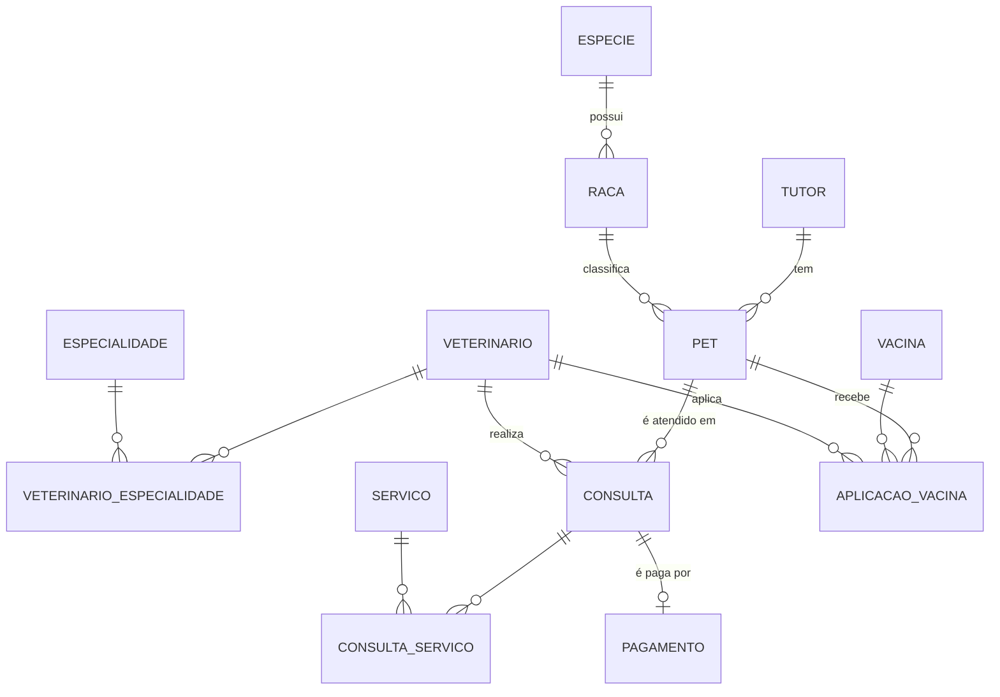

# 🐾 Banco de Dados — Clínica Veterinária

Banco de dados relacional completo para uma clínica veterinária, em **MySQL 8**. Ele vai do levantamento de requisitos até triggers, views e procedures, e cada etapa vem com a explicação das decisões tomadas.

> 🚧 **Em construção.** O projeto é desenvolvido por etapas, e o progresso fica no [roteiro](#-roteiro) abaixo.


---

## 📋 Requisitos do negócio

- Um **tutor** (dono) pode ter vários **pets**, e cada pet pertence a um único tutor
- Todo pet tem **espécie** e **raça** padronizadas (nada de "cachoro" e "Cão" no mesmo relatório)
- **Veterinários** têm uma ou mais **especialidades**
- Uma **consulta** liga um pet a um veterinário em uma data/hora, e o veterinário não pode ter dois atendimentos no mesmo horário
- Numa consulta podem ser cobrados vários **serviços** (exame, vacina, curativo...), e o preço cobrado fica registrado mesmo que o preço de tabela mude depois
- A **carteira de vacinação** registra cada aplicação e calcula a data da próxima dose
- Cada consulta é **paga** uma única vez

## 🧩 Modelo entidade-relacionamento



## 🧠 Decisões de modelagem

| Decisão | Por quê |
|---|---|
| `especie` e `raca` em tabelas próprias | **Normalização**: evita texto livre repetido e inconsistente |
| N:N resolvido com tabela associativa (`veterinario_especialidade`, `consulta_servico`) | Banco relacional não guarda lista dentro de uma coluna. A PK composta impede duplicidade |
| `preco_cobrado` em `consulta_servico` | Guarda o **preço histórico**, porque o `preco_base` do serviço pode mudar |
| `UNIQUE (id_veterinario, data_hora)` | O próprio banco impede **conflito de agenda** |
| Dinheiro em `DECIMAL(10,2)` | `FLOAT` gera erro de arredondamento (0,1 + 0,2 ≠ 0,3) |
| CPF em `CHAR(11)` | Tamanho fixo e sem máscara. A formatação é papel da aplicação |
| `pet.ativo` em vez de `DELETE` | **Exclusão lógica**: preserva o histórico de consultas e vacinas |
| Constraints nomeadas (`pk_`, `fk_`, `uq_`, `ck_`) | Mensagens de erro legíveis e manutenção mais fácil |

## 🗺️ Roteiro

- [x] **Etapa 1:** requisitos, modelo ER e criação das tabelas → [`sql/01_schema.sql`](sql/01_schema.sql)
- [ ] **Etapa 2:** tabela de pagamento (1:1)
- [ ] **Etapa 3:** dados de teste realistas
- [ ] **Etapa 4:** triggers (próxima dose da vacina, preço automático)
- [ ] **Etapa 5:** views (agenda do dia, vacinas atrasadas, faturamento mensal)
- [ ] **Etapa 6:** procedures e functions (agendar consulta com validação, idade do pet)
- [ ] **Etapa 7:** consultas de negócio com JOIN, GROUP BY e subqueries

## ▶️ Como rodar

**1. Suba um MySQL 8.4 com Docker** (ou use um MySQL instalado na máquina):

```bash
docker run --name clinica-mysql -e MYSQL_ROOT_PASSWORD=sua_senha -p 3306:3306 -d mysql:8.4
```

**2. Execute os scripts em ordem**, pelo MySQL Workbench ou pelo terminal:

```bash
mysql -h 127.0.0.1 -u root -p < sql/01_schema.sql
```

---

Feito por **[Bruno Gadelha](https://github.com/Bruno-Gadelha25)**, estudante de Banco de Dados.
